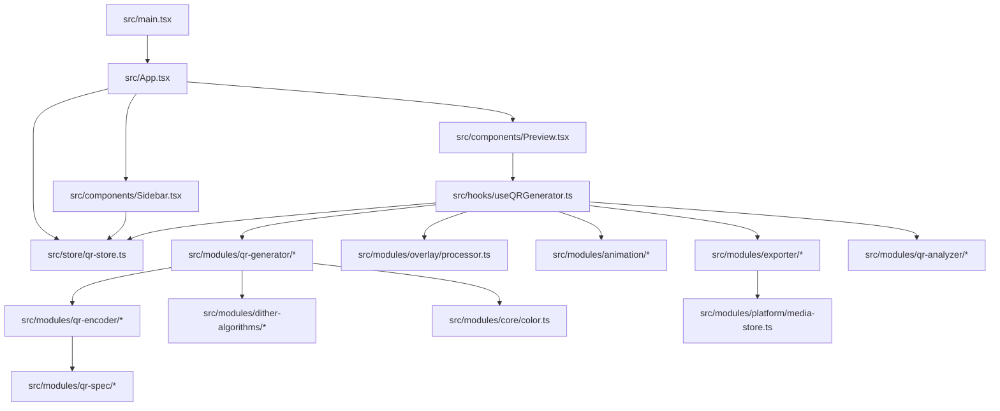
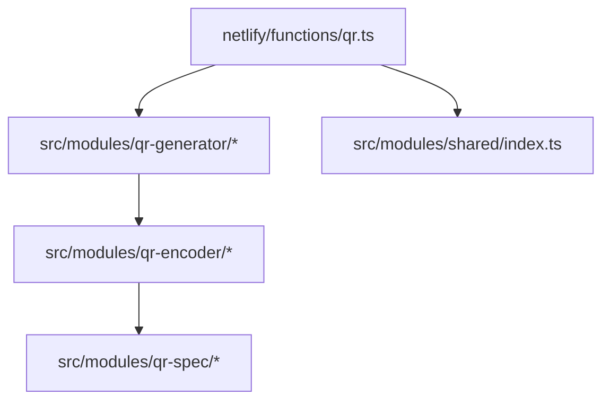
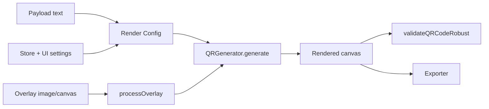

# ANQR Codebase Knowledge (knowledge.md)

Updated: 2026-02-18 (Australia/Melbourne)


## Architecture at a glance

ANQR is a **React + Vite** web app (also wrapped by **Capacitor** for Android) that lets users configure and render QR codes (static or animated) with styling, overlays, watermarks, safety checks, sharing links, and exports.

There are three “execution surfaces” that all reuse the same core renderer:

1. **Web / Capacitor app**: interactive editor UI builds a config from state and renders into a `<canvas>`.
2. **Netlify Function (`netlify/functions/qr.ts`)**: server-side image generator used for `https://anqr.link/?...` style embed URLs (e.g. ``).
3. **Android native plugin**: a Capacitor plugin used to write files to the device’s Documents folder (MediaStore).

Key design idea: a single “QR render config object” is assembled from UI state, then passed into `src/modules/qr-generator/qr-generator-class.ts` to produce a canvas (and optionally matrix data for vector export).

## Core runtime flow (web)



### Step-by-step (editor)

1. **Boot** (`src/main.tsx`)
   - Creates the React root.
   - Wraps the app in providers (i18n, tooltips, error boundary).
2. **App controller** (`src/App.tsx`)
   - Chooses between “editor” vs static pages.
   - Parses URL params (`parseUrlParams`) to pre-load editor settings.
3. **State** (`src/store/qr-store.ts`)
   - Single Zustand store holds *all* editor settings: payload, encoding, render style, overlay, watermark, animation, output, safety, metadata, ads/QA, etc.
4. **UI** (components + sections)
   - Sidebar sections update slices of the store (e.g. Render / Overlay / Watermark).
   - Preview consumes the store and the generator hook to show render output + warnings.
5. **Generate** (`src/hooks/useQRGenerator.ts`)
   - Subscribes to store slices.
   - Builds a **debounced** generator config object.
   - Loads overlay images (static or animated), preprocesses them, and calls:
     - `qrGenerator.generate(config, overlayCanvas?)`
   - Copies the generated canvas into a visible canvas element.
   - Optionally validates by scanning the output canvas (`validateQRCodeRobust`).
6. **Export/share**
   - Export uses `src/modules/exporter/*` (PNG/WebP/JPEG/GIF/SVG/vector SVG).
   - Sharing uses `src/modules/share-links/*` (URL params + embed snippets).

## Core runtime flow (server / embed)

The Netlify function takes **query parameters**, maps them to the same render config used by the app, generates on a Node canvas (`@napi-rs/canvas`), and returns an image response.



Important implication: **URL parameter compatibility** is enforced in two places:
- Client share encoder/decoder (`src/modules/share-links/url-params.ts`)
- Server query parser (`netlify/functions/qr.ts`)

If either side adds options without the other being updated, you can get subtle “web looks different from  embed” mismatches.

## State model (how the UI maps to generation)

The store is intentionally “section-shaped”:

- `payload` → what data is encoded (URL/text/WiFi/payment/etc).
- `qr` → QR spec: version, encoding mode, ECC, mask, quiet zone, etc.
- `render` → visual style: module size, styles, gaps, finder/timing/alignment, gradients, per-module color, etc.
- `overlay` → overlay image selection, crop/fit, blend mode, dithering, transforms.
- `watermark` → optional watermark pattern/text and placement.
- `animation` → source frames + playback parameters for animated output.
- `safety` + `auto` → auto ECC choices + enforcement (min module/quiet zone, overlay intensity caps, contrast warnings).
- `output` + `metadata` → export format, dimensions, DPI, embedded metadata.

The renderer config assembled in `useQRGenerator.ts` is effectively the *canonical mapping* from those slices to the actual generation engine.

## Render pipeline (what actually happens)

At a high-level, the pipeline is:



Where:
- `Payload text` comes from `qr-store.ts` via `getPayloadText()` and `payload-generators/*`.
- Overlay preprocessing is in `src/modules/overlay/processor.ts` (+ `overlay-filters.ts` / `dither-algorithms/*`).
- Rendering + styling + compositing is `src/modules/qr-generator/*` (backed by `qr-encoder/*` and `qr-spec/*`).
- Validation + safety checks are in `src/modules/qr-analyzer/*`.
- Export is `src/modules/exporter/*` (plus native file writing via `src/modules/platform/media-store.ts`).

## URL parameter parity (client share encoder vs server image function)

Parity is now **closed**:

- Client parser (`src/modules/share-links/url-params.ts`): **169** keys
- Server parser (`netlify/functions/qr.ts`): **169** keys
- Client-only: **0**
- Server-only: **0**

Reference artifacts:
- `reports/param-parity.json` (committed baseline, read by signoff check)
- `tests/unit/share-param-parity.spec.ts`

Compatibility note:
- Both client and server accept legacy per-ECC keys (`maxOverlayIntensity*`) and canonical keys (`maxInt*`) to keep old links working.

Recommended workflow:
- Treat `src/modules/share-links/url-params.ts` as the canonical list of public query params.
- Keep `tests/unit/share-param-parity.spec.ts` failing on any key-set drift (allowlists at zero).

## Supporting (non-73) files worth knowing about

These are not in the “73 code files” list you provided, but they materially affect runtime:

- `netlify/functions/qr.ts` — server-side renderer for embed URLs (`anqr.link/?...`). Also includes Sentry release tag (`anqr@<version>` from package.json).
- `netlify/edge-functions/seo.ts` — Netlify Edge Function for SSR meta tag injection. Handles per-page static meta tags AND dynamic OG meta tags for shared QR code URLs (`/?data=...`).
- `src/modules/shared/index.ts` — pure utilities intended to be shared client/server.
- `android/app/src/main/java/link/anqr/app/MediaStoreWriterPlugin.java` — native file writer for Android via Capacitor.
- `android/app/src/main/java/link/anqr/app/MainActivity.java` — Android bootstrap.
- `scripts/check-sentry-regression.mjs` — Sentry regression monitor. Queries all 3 projects for unresolved issues, writes `reports/sentry-regression.json`. Run via `make check:sentry`.
- `vite.config.ts`, `capacitor.config.ts`, `netlify.toml`, `Makefile` — build/runtime configuration.

This document references them when needed.

## Subsystem deep dives

### 1) UI: editor shell + sections

- `src/App.tsx` orchestrates:
  - URL param ingest (`parseUrlParams`) → store update
  - screen routing (editor vs gallery/static pages)
  - layout state (sidebar open, mode/tier selection)
- `src/components/Header.tsx` provides navigation + “level” selection (basic/advanced/pro).
- `src/components/Sidebar.tsx` is the settings host:
  - Each accordion section maps to one “slice” of the store:
    - Payload → `payload`
    - QR encoding → `qr`
    - Render → `render`
    - Overlay → `overlay`
    - Watermark → `watermark`
    - Animation → `animation`
    - Safety → `safety` (+ `auto`)
    - Output → `output`
    - Metadata → `metadata`
    - Share → uses `share-links`
- `src/components/Preview.tsx` is the output surface:
  - Holds the visible `<canvas>`
  - Shows warnings (contrast, overlay intensity, quiet zone)
  - Offers quick preview toggles and validation status

### 2) State: `src/store/qr-store.ts`

Zustand store provides:
- **Types** for all settings (enums/unions used across UI and renderer)
- **Initial defaults** (the default “look” of the generator)
- **Actions** to update slices (usually shallow merges for section-local updates)
- **Derived helpers** like “build payload string” (via `payload-generators.ts`)
- **QA / telemetry toggles** (e.g. debug heatmaps, blur/contrast checks)

In practice:
- UI code should *only* read/write the store.
- Rendering code should not depend on UI components; it depends on store + pure modules.

### 3) Generation: `src/hooks/useQRGenerator.ts`

This is the “engine room” of the app.
It:
- reads store slices
- computes `safetyAdjustedConfig` and the final `debouncedConfig`
- loads/prepares overlay canvases
- manages animation playback state + derived frames
- calls the generator and pushes results into:
  - `canvas` (for display/export)
  - `qrMatrix` (for vector SVG export)

It also performs:
- **Validation scan** of the generated canvas (skipped while animating for perf)
- **Ad gating hooks** (interstitials/banner via `admob-service.ts`)
- **Export** orchestration via `exporter.ts`

### 4) Rendering core: `src/modules/qr-generator/*`

`QRGenerator`:
- computes QR matrix (via `src/modules/qr-encoder/*` + `src/modules/qr-spec/*`)
- identifies structural modules (finder/timing/alignment/format/version)
- draws modules with style options (shapes, corners, eye styles, gaps)
- supports gradients and per-module color logic
- applies overlay constraints (skip/lock certain regions; blend)
- supports dithering / blue-noise decisions for overlays and style effects
- maintains memoization caches to keep the editor responsive

The generator keeps the last matrix for vector export (`getLastMatrix()`).

### 5) Overlay and image preprocessing: `src/modules/overlay/processor.ts`

Responsibilities:
- load images from file or URL into a canvas
- resize/crop according to fit mode
- apply transforms (rotate/flip/scale)
- apply filters (brightness/contrast/gamma/blur/threshold/edge/etc) via `overlay-filters.ts`
- apply dithering defaults via `dither-algorithms/*`
- provide helpers (fit, crop, loadImage, applyCanvasBlendMode)

### 6) Animation: `src/modules/animation/*` + temporal dither in QR generator

- Detects and parses animated sources (GIF, APNG, animated WebP where supported).
- Converts frames into canvases / pixel buffers.
- Provides frame timing and playback helpers.
- Temporal dithering can be used to reduce banding/flicker across frames in animated output.

### 7) Safety + validation: `src/modules/qr-analyzer/*`

- **Safety analyzer** evaluates config risks:
  - quiet zone violations
  - module size too small
  - overlay intensity too high / too destructive
  - low contrast
- **Scanner** decodes the rendered canvas and compares result to intended content.
  - used as a regression guard: “the pretty QR still scans”
- **Structured export builder** (`src/modules/qr-analyzer/export.ts`) produces normalized JSON diagnostics for analysis export and test harnesses (`buildAnalysisExportData`).
- Decoder now emits geometry diagnostics (`QRAnalysisResult.geometry`) including corners, bounding box, and estimated rotation.

### 8) Export: `src/modules/exporter/*` + `src/modules/platform/media-store.ts`

Exports:
- Raster: PNG / JPEG / WebP
- Animated: GIF (with quantization/dither settings)
- Vector: SVG (and “vector SVG” built from module matrix)

Also:
- embeds metadata (optional)
- native Android save path uses Capacitor MediaStore with method-name compatibility (`saveBase64ToDocuments` and `saveToDocuments`) in `src/modules/platform/media-store.ts`.
- writes to disk in browser (download) or Android Documents (MediaStore plugin)

### 9) Sharing: `src/modules/share-links/*`

- Canonical encoder/decoder for URL parameters.
- Generates “embed code” and social share URLs.
- Updates the browser URL without full reload (`updateBrowserUrl`).
- Also acts as the **public contract** for which settings are shareable.

---

# Module directory reference (current)

> This replaces the obsolete per-file list. Use `ls src/modules` or `rg` for a full file inventory.

## Core modules (runtime)
- **src/modules/qr-generator/** — rendering pipeline (qr-generator-class, render-loop, scaled-render, pixel-matrix, render-modes, overlay transforms, dithering, caches).
- **src/modules/qr-encoder/** — encoding, bit buffer, RS blocks, masks, segment optimization.
- **src/modules/qr-spec/** — pattern detection, capacities, masks, structural verification.
- **src/modules/qr-decoder/** — binarizer, locator, extractor, RS decode, reader + adapter.
- **src/modules/qr-analyzer/** — safety checks, scan simulation, telemetry, decoder integration.

## Visual / effects
- **src/modules/overlay/** — overlay processing, crop, filters, watermark, canvas blend modes.
- **src/modules/dither-algorithms/** — ordered, error-diffusion, blue-noise, temporal dithering.
- **src/modules/animation/** — animated sources + pattern effects.
- **src/modules/qr-art/** — QR art generation + validations.
- **src/modules/core/** — color/contrast/gradient/harmony/math utilities.

## Output & sharing
- **src/modules/exporter/** — PNG/WebP/GIF/SVG export + metadata.
- **src/modules/share-links/** — URL params + embed + social links.
- **src/modules/platform/** — AdMob + MediaStore integration for mobile exports.

## UI anchors
- **src/components/Preview.tsx** — live canvas + warnings.
- **src/components/Analyze.tsx** — analysis UI.
- **src/components/sections/** — generator controls.

## i18n Translation Workflow

The authoritative list of **86 Google Play supported language codes** is defined in `src/i18n/index.ts` (the `languages` array with code, name, nativeName, flag, and RTL metadata). This is the single source of truth for supported locales.

There are **TWO separate i18n systems** in this project:

1. **UI Strings (locales)**: Button labels, menu items, tooltips - uses `src/i18n/locales/txt/*.txt` + `template.json`
2. **Static Content (pages)**: Privacy, Terms, About, Guide, Learn, Examples pages - uses `src/i18n/static/txt/*.txt` + `template-*.ts`

---

### ⚠️ CRITICAL: NEVER EDIT GENERATED FILES DIRECTLY ⚠️

**YOU MUST NEVER DIRECTLY EDIT:**
- `src/i18n/locales/*.json` - These are GENERATED from txt + template.json
- `src/i18n/static/<lang>/*.ts` (e.g., `en-GB/privacy.ts`) - These are GENERATED from txt + template-*.ts

**YOU MUST ONLY EDIT:**
- `src/i18n/locales/txt/en-GB.txt` - Master English UI strings
- `src/i18n/locales/template.json` - Maps JSON keys to line numbers
- `src/i18n/static/txt/en-GB.txt` - Master English static content
- `src/i18n/static/txt/template-*.ts` - Template files with line number references

Editing generated files directly will:
1. Break translation detection (xlate.py won't see your changes)
2. Get overwritten next time `make i18n:fill` runs
3. Cause inconsistencies across languages

---

### UI Strings System (`src/i18n/locales/`)

#### How It Works

1. **Source of Truth**: `txt/en-GB.txt` is the master English translation file
2. **Line Numbers**: Each string has a unique line number (e.g., `1427\t"Generate"`)
3. **Template Mapping**: `template.json` maps translation keys to line numbers (e.g., `"feature1Title": "1427"`)
4. **Translation Detection**: `xlate.py` only translates lines that are **missing** in other language `.txt` files

#### Rules for Adding/Changing Strings

1. **New strings = NEW incremental line numbers** at the end of `en-GB.txt`
2. **Changing existing strings = Add NEW line numbers** with the new text, then update `template.json` to point to the new line numbers
3. **Blank out old strings** that are being replaced by setting them to an empty placeholder like `"(deprecated)"` or `"_"` - this prevents stale translations from being used
4. **Never delete line numbers** - this would break the line number alignment across all language files

#### Example: Updating a UI String

```bash
# 1. Add new strings at end of txt/en-GB.txt (e.g., lines 1774-1780)
# 2. Blank out the old strings you're replacing (e.g., line 1427 becomes: 1427\t"_")
# 3. Update template.json to point to new line numbers
# 4. User runs: make i18n:xlate (translates new lines to all languages)
# 5. User runs: make i18n:fill (generates JSON files from txt files)
```

---

### Static Content System (`src/i18n/static/`)

#### How It Works

1. **Source of Truth**: `txt/en-GB.txt` contains all translatable strings with line numbers
2. **Template Files**: `txt/template-*.ts` files contain page structure with line number references instead of text
   - Example: `title: '374'` means "use the string from line 374 of the txt file"
3. **Generated Files**: `fill.py` reads the template + txt file and generates the actual `<lang>/*.ts` files

#### File Structure

```
src/i18n/static/
├── txt/
│   ├── en-GB.txt           # Master English content (line numbers → strings)
│   ├── de-DE.txt           # German translations
│   ├── fr-FR.txt           # French translations
│   ├── template-privacy.ts # Privacy page template (uses line number refs)
│   ├── template-terms.ts   # Terms page template
│   ├── template-about.ts   # About page template
│   └── ...                 # Other templates
├── en-GB/
│   ├── privacy.ts          # GENERATED - DO NOT EDIT
│   ├── terms.ts            # GENERATED - DO NOT EDIT
│   └── ...                 # GENERATED files
├── de-DE/                  # GENERATED - DO NOT EDIT
├── fr-FR/                  # GENERATED - DO NOT EDIT
└── fill.py                 # Script that generates <lang>/*.ts from txt + templates
```

#### Rules for Adding/Changing Static Content

1. **New content = Add NEW lines at END of `txt/en-GB.txt`**
   - Format: `<line_number>\t"<content>"`
   - Example: `1333\t"Full Privacy Policy"`

2. **Update the template file** (`txt/template-*.ts`) to reference the new line numbers
   - Example: Add a new section with `heading: '1333'`

3. **Never modify line numbers or reorder lines** - this breaks alignment across all language files

4. **Changing existing content = Add NEW line numbers** with new text, update template to use new numbers

#### Example: Adding a New Section to Privacy Page

```bash
# 1. Add new lines at END of txt/en-GB.txt:
#    1333\t"Full Privacy Policy"
#    1334\t"For the complete, legally binding privacy policy, please visit our privacy policy page."
#    1335\t"View Full Privacy Policy on iubenda"

# 2. Update txt/template-privacy.ts to add new section:
#    {
#      heading: '1333',
#      paragraphs: ['1334'],
#      links: [{ href: 'https://...', label: '1335' }],
#    },

# 3. User runs: make i18n:xlate (translates new lines to all languages)
# 4. User runs: make i18n:fill (generates the actual .ts files)
```

---

### Make Commands (USER RUNS THESE - NEVER RUN AUTOMATICALLY)

**IMPORTANT**: The AI assistant must NEVER run these commands. The user will always run them manually after reviewing the changes to source files. (They are also automated as non-blocking steps in `make all`.)

- `make i18n:xlate` - Translates missing lines in `en-GB.txt` to all other language `.txt` files. Automated in `make all` step 3.
- `make i18n:fill` - Generates output files (JSON for locales, TS for static) from txt + templates. Automated in `make all` step 4.
- `make i18n:sync` - Runs both xlate and fill
- `make report:i18n:txt` - Checks txt files for untranslated strings, line-count mismatches, and English-heavy warnings

Translation uses **Google Translate only** (`translate.googleapis.com` gtx endpoint — free, no API key required).

---

## Community Translations

Translation files are open-sourced in a separate public repository to allow community contributions:

- **Public repo**: https://github.com/maldous/anqr-i18n
- **Branches**:
  - `static` - Static content translations (guides, about pages)
  - `locales` - UI string translations
- **Auto-sync**: `i18n:pull` (step 2) and `i18n:push` (step 16) are now part of the `make all` pipeline as non-blocking steps
- **Contributing**: See the README in the public repo for contribution guidelines

## Professional Logging Standards

The codebase uses a **unified professional logging system** implemented in `src/lib/logger.ts`. All code must use this system - **no direct `console.*` calls are allowed** (enforced by Biome lint rule `noConsole: "error"`).

### Core Principles

1. **Single Source of Truth**: All logging goes through `src/lib/logger.ts`
2. **No Legacy Patterns**: No wrapper loggers, no direct console calls, no module-specific logging implementations
3. **Consistent Interface**: All loggers use the same `Logger` interface with `trace/debug/info/warn/error` methods
4. **Sentry Integration**: Warnings recorded as breadcrumbs, errors sent as events
5. **Sensitive Data Redaction**: Automatic redaction of passwords, tokens, API keys, etc.

### Logger Interface

```typescript
import { createLogger } from '@/lib/logger';

const log = createLogger('SCOPE_NAME');

log.trace('High-volume diagnostic', { pixels: 1000 });  // Inner loops only
log.debug('Processing step', { width: 100, height: 100 }); // Development diagnostics
log.info('Operation complete', { duration: 150 });      // Lifecycle milestones
log.warn('Fallback triggered', { reason: 'timeout' });  // Recoverable issues
log.error('Operation failed', { error });               // Failures
```

### Log Levels (in order of verbosity)

| Level | Purpose | Development | Production | Sentry |
|-------|---------|-------------|------------|--------|
| `trace` | Very high-volume diagnostics (decoder inner loops, per-pixel operations) | OFF* | OFF | None |
| `debug` | Development diagnostics (function entry/exit, state changes, config values) | **ON (default)** | OFF | None |
| `info` | Lifecycle milestones (initialization, export complete, mode changes) | ON | OFF | None |
| `warn` | Unexpected but recoverable (fallback triggered, deprecated usage, low contrast) | ON | ON | Breadcrumb |
| `error` | Failures (unrecoverable errors, failed operations, exceptions) | ON | **ON (default)** | Event |

*trace requires explicit `setLogLevel('trace')` even in development

### Default Log Levels

- **Development** (`import.meta.env.DEV === true`): `debug` (maximum visibility)
- **Production**: `error` (minimum noise - only failures shown)

### Toggling Log Levels at Runtime

```javascript
// In browser console - enable debug logging for 30 minutes
window.anqrDiag.enable(30, 'debugging overlay issue')

// Disable and revert to production default
window.anqrDiag.disable()

// Check current status
window.anqrDiag.status()

// Show help
window.anqrDiag.help()
```

### Log Buffer (for debugging failed operations)

The logger supports capturing logs to a buffer for debugging failed operations (e.g., QR detection failures):

```typescript
import { enableLogBuffer, flushLogBuffer, disableLogBuffer, getBufferSize, clearLogBuffer } from '@/lib/logger';

enableLogBuffer();           // Start capturing (clears existing buffer)
// ... do something that might fail ...
const debugLog = flushLogBuffer(); // Get captured logs as string and clear
disableLogBuffer();          // Stop capturing

// Utilities
getBufferSize();  // Returns current buffer length
clearLogBuffer(); // Clears buffer without disabling
```

**Buffer Limits:**
- Maximum size: **1000 entries** (oldest entries dropped when exceeded)
- Entries include **ISO 8601 timestamps**: `2024-01-15T10:30:45.123Z [SCOPE:level] message`
- Buffer captures even when console output is suppressed (production mode)

### Standard Scope Prefixes

When creating a logger, use one of these standard scope names. **If a new scope is needed, add it to `SCOPE_PREFIXES` in `src/lib/logger.ts` first.**

#### App Shell
| Prefix | Module/File |
|--------|-------------|
| `MAIN` | src/main.tsx |
| `APP` | src/App.tsx |
| `ERROR` | src/components/ErrorBoundary.tsx |
| `HEADER` | src/components/Header.tsx |
| `DIAG` | src/lib/logger-remote.ts |

#### UI Components
| Prefix | Module/File |
|--------|-------------|
| `ANALYZE` | src/components/Analyze.tsx |
| `OVERLAY` | src/components/sections/OverlaySection.tsx |
| `PAYLOAD` | src/components/sections/PayloadSection.tsx |
| `HELP` | src/components/ui/help-link.tsx |
| `GALLERY` | src/components/Gallery.tsx |
| `SIDEBAR` | src/components/Sidebar.tsx |
| `PREVIEW` | src/components/Preview.tsx |
| `WELCOME` | src/components/WelcomeModal.tsx |

#### QR Generation Pipeline
| Prefix | Module/File |
|--------|-------------|
| `QRGEN` | src/hooks/useQRGenerator.ts |
| `GENERATE` | src/modules/qr-generator/ (all files) |
| `DITHER` | src/modules/qr-generator/pixel-matrix-dithered.ts |
| `ENCODER` | src/modules/qr-encoder/ |
| `SPEC` | src/modules/qr-spec/ |

#### QR Analysis Pipeline
| Prefix | Module/File |
|--------|-------------|
| `DECODER` | src/modules/qr-decoder/ |
| `ANALYZER` | src/modules/qr-analyzer/ |
| `SCANNER` | src/modules/qr-analyzer/scanner.ts |
| `SAFETY` | src/modules/qr-analyzer/safety.ts |

#### Export & Sharing
| Prefix | Module/File |
|--------|-------------|
| `EXPORT` | src/modules/exporter/ |
| `SHARE` | src/modules/share-links/ |
| `CLIPBOARD` | src/modules/browser-clipboard/ |
| `DOWNLOAD` | src/modules/browser-io/ |

#### Media & Effects
| Prefix | Module/File |
|--------|-------------|
| `ANIMATION` | src/modules/animation/ |
| `WATERMARK` | src/modules/overlay/watermark.ts |
| `TELEMETRY` | src/modules/qr-analyzer/telemetry-*.ts |

#### Data & Platform
| Prefix | Module/File |
|--------|-------------|
| `I18N` | src/i18n/index.ts |
| `STATIC` | src/i18n/static/index.ts |
| `PLATFORM` | src/modules/platform/ |
| `ADMOB` | src/modules/platform/admob.ts |
| `STORAGE` | src/modules/platform/media-store.ts |

#### Advanced Features
| Prefix | Module/File |
|--------|-------------|
| `QART` | src/modules/qr-art/ |
| `CORE` | src/modules/core/ |
| `COLOR` | src/modules/core/color.ts |
| `GRADIENT` | src/modules/core/gradient.ts |

### Logging Rules for New Code

1. **Import the logger**:
   ```typescript
   import { createLogger } from '@/lib/logger';
   // or for path aliases:
   import { createLogger } from '../../lib/logger';
   ```

2. **Create a scoped logger** at module level:
   ```typescript
   const log = createLogger('SCOPE_NAME');
   ```

3. **Use appropriate log levels**:
   - `trace`: Only for inner loops that execute 1000s of times
   - `debug`: Normal development diagnostics
   - `info`: Significant state transitions (init complete, export done)
   - `warn`: Something unexpected but handled (Sentry breadcrumb)
   - `error`: Something failed (Sentry event)

4. **Use structured context objects** (not string concatenation):
   ```typescript
   // GOOD
   log.debug('Processing image', { width, height, format });
   
   // BAD
   log.debug(`Processing image: ${width}x${height} (${format})`);
   ```

5. **Don't include scope prefix in message** (logger adds it automatically):
   ```typescript
   // GOOD
   log.debug('Starting decode');
   
   // BAD
   log.debug('[DECODER] Starting decode');
   ```

6. **Pass errors in context object**:
   ```typescript
   try {
     // ...
   } catch (error) {
     log.error('Operation failed', { error });  // Sentry captures the error
   }
   ```

### Sensitive Data Redaction

The following keys are automatically redacted from log context:
- `password`, `token`, `secret`, `apiKey`, `api_key`
- `authorization`, `auth`, `credential`
- `sessionId`, `session_id`, `accessToken`, `access_token`
- `refreshToken`, `refresh_token`, `privateKey`, `private_key`

### Configuration Constants

| Constant | Value | Purpose |
|----------|-------|--------|
| `MAX_BUFFER_SIZE` | 1000 | Maximum log buffer entries before oldest are dropped |
| `MAX_CONTEXT_DEPTH` | 10 | Maximum object nesting depth for context serialization |

---

## Gallery System

The gallery is a **fully automated, config-driven hero page** showcasing all ANQR capabilities. It is NOT a manually curated showcase — the whole gallery IS the validated showcase.

### Architecture

- **Gallery data**: `src/data/gallery-items.ts` — defines all `GalleryItem`s and `GallerySection`s (12 sections, ~160 items)
- **Scan scenarios**: `src/data/gallery-scan-scenarios.ts` — 46 Tier-A scan-validated scenarios used by the scan matrix test
- **Gallery UI**: `src/components/Gallery.tsx` — renders sections with hover cards, ads, i18n, mobile filters
- **Image generation**: `scripts/generate-gallery.mjs` — Puppeteer-based PNG/GIF capture from dev server
- **Manifest**: `public/gallery/manifest.json` — auto-generated index of all gallery items

### Gallery Sections (in order)

1. `plain` — Plain QR codes (versions, ECC levels)
2. `content-types` — Payload types (vCard, WiFi, email, SMS, geo, event)
3. `styles` — Module + finder styles (square, rounded, dots, diamond, connected)
4. `colors` — Color themes and gradients
5. `image-overlay` — Static image overlays (dithered, blue-noise, halftone, etc.)
6. `animation-overlay` — Animated overlays (GIF sources)
7. `blend-modes` — Branded blend presets
8. `color-modes` — Color processing (grayscale, B&W, duotone)
9. `preprocessing` — Image filters (brightness, contrast, gamma, sharpen, posterize, edge detection)
10. `dithering` — Dithering algorithms (error diffusion, Bayer, blue noise, Floyd-Steinberg, Atkinson, etc.)
11. `encoding` — QR encoding options (versions, ECC, byte mode)
12. `power-combos` — Curated multi-feature combinations

### Gallery Generation Pipeline

```bash
make gallery:fresh    # Clean + regenerate all gallery images (needs dev server on :5173)
make gallery          # Regenerate without cleaning
make gallery:auto     # Scan matrix → copy approved artifacts → manifest
make all              # Full 16-step pipeline including gallery + PWA screenshots (auto-manages preview server)
```

Gallery images are hosted on Netlify (anqr.link) to keep the app bundle small. After `make deploy`, gallery images load from `https://anqr.link/gallery/`.

### Ad Slots

Ad slots are inserted after every gallery section. Slot names follow the pattern `gallery-after-{section-id}`. All slot IDs are configured in the Makefile via `VITE_ADSENSE_SLOT_GALLERY_AFTER_*` environment variables.

---

## Production Findings (Overlay Scannability)

Empirical findings from 46 scenarios × 4 fixtures × 2 tiers = 368 scan matrix runs.

### Fixture Difficulty Ranking

| Fixture | Tier A | Notes |
|---------|-------:|-------|
| logo.png | ~96% | Easiest — simple shapes, high contrast |
| test.png | ~90% | Synthetic, predictable geometry |
| tsunami.jpg | ~86% | Photographic, moderate detail |
| king.gif | ~83% | Hardest — animated, high detail, saturated |

**Key insight:** king.gif drops catastrophically without scan gate assistance. Animated/high-detail fixtures are dependent on scan gate retries.

### Overlay Mode Scannability

- **Reliable (4/4 fixtures):** `dithered`, `subpixel`, `halftone`, `extreme`, `duotone`, `pixelate`, `blend`
- **Fragile (2/4):** `blue-noise` — fails on complex fixtures
- **Risky (0-1/4):** `mosaic` — systemic contrast collapse (fixed in iteration 2 to 4/4)

### Preservation Mode Risk

- `balanced` (preserveFinders+timing+alignment): Safe default
- `strength-100`: Borderline — fails on king
- `blendPreservations: true`: **High risk** — should be OFF by default

### Two-Tier Testing Methodology

| | Tier A (Production) | Tier B (Diagnostic) |
|---|---|---|
| Purpose | What users see | Intrinsic scannability |
| `scanGateProfile` | `'preview'` | `'off'` |
| `overlayIntensity` | 70 | 65 |
| `qrBitBiasStrength` | 0.15 | 0 |

---

## Ad Monetization Architecture

### Desktop (AdSense)

- All slot IDs configured in Makefile via `VITE_ADSENSE_SLOT_*` env vars
- Test mode: `VITE_ADSENSE_TEST_MODE=true` (switch to `false` after Google approval)
- Slot types: skyscrapers (left/right rails), page top/bottom, gallery section dividers
- 46 total slot names across all pages (editor, gallery, static pages)

### Native (AdMob via Capacitor)

- Banner (top/bottom), interstitial (export/gallery/generation), rewarded (premium tier, HD export)
- All unit IDs in Makefile via `VITE_ADMOB_*` env vars
- Test mode: `VITE_ADMOB_TESTING=true`
- Professional tier gated by rewarded ads in `Header.tsx`

---

## Android / Capacitor

- Capacitor wraps the Vite web app for Android
- Native plugin: `MediaStoreWriterPlugin.java` writes exports to Documents via MediaStore
- Gallery images load from anqr.link (not bundled in APK)
- Overlay gallery built-ins use same-origin bundled assets (`/tsunami.jpg`, `/king.gif`, `/logo.png`, `/test.png`)
- Pre-compressed files (`.gz`, `.br`) removed during `android:sync` to avoid asset merger conflicts

### Key Android Commands

```bash
make android:build    # Debug APK
make android:release  # Release AAB for Play Store
make android:run      # Run on connected device/emulator
make android:upload   # Build + upload to Play Store
```

---

## Version Management

ANQR uses a unified versioning convention: **`1.0.{N}`** where `N` is the Android `versionCode` (a monotonically increasing integer required by the Play Store).

### Three locations, one version

| Location | Key | Example | Purpose |
|----------|-----|---------|--------|
| `package.json` | `"version"` | `"1.0.66"` | npm/Vite/Sentry release name (`anqr@1.0.66`) |
| `android/app/build.gradle` | `versionName` | `"1.0.66"` | User-facing version shown in Play Store |
| `android/app/build.gradle` | `versionCode` | `66` | Play Store upload counter (must increase each upload) |

### How it stays in sync

`make android:bump` is the **single command** that increments all three values in lockstep:
1. Reads the current `versionCode` from `build.gradle`
2. Increments it by 1
3. Computes `NEW_VER = 1.0.{new_code}`
4. Updates `versionCode` and `versionName` in `build.gradle`
5. Updates `"version"` in `package.json`

This runs automatically as part of `make all` step 14 (before `android:release`).

### Sentry integration

`vite.config.ts` reads the version from `package.json` via `process.env.npm_package_version` to generate the Sentry release name:
```
const sentryRelease = process.env.SENTRY_RELEASE || `anqr@${process.env.npm_package_version || '1.0.0'}`;
```

Both `sentryVitePlugin` instances (anqr-web and anqr-mobile) include:
- `setCommits: { auto: true, ignoreMissing: true, ignoreEmpty: true }` — associates git commits with each release (enables "suspect commits" in Sentry)
- `finalize: true` — marks releases as finalized after deploy
- `deploy: { env: 'production' }` — records the deployment environment

The server-side function (`netlify/functions/qr.ts`) also tags errors with `release: 'anqr@<version>'` via static import from `package.json`.

After a version bump, the next `npm run build` (or `make build` / `make deploy`) will automatically tag the Sentry release with the new version.

### Rules

- **Never edit version numbers manually** — always use `make android:bump`.
- The `versionCode` must **never decrease** (Play Store rejects it).
- Major/minor bumps (e.g. `1.0.N` → `1.1.0` or `2.0.0`) are done manually when a significant release warrants it, then `make android:bump` continues incrementing the patch from there.

---

## Testing Strategy

### Fast Local Loop

```bash
make test:unit        # ~30s — Vitest unit tests (excludes heavyweight)
make test:tiers       # Playwright tier tests (basic + advanced + pro)
make check:sentry     # ~5s — Check Sentry for unresolved issues (regression monitor)
```

### Full Quality Gate

```bash
make quality          # 18 checks: biome, tsc, lockfile, licenses, type-coverage,
                      # duplication, spelling, inventories, unit tests, test-ids,
                      # i18n, depcruise, audit, osv-scanner, semgrep, knip, bundle budget
```

### Heavyweight (Explicit/CI)

```bash
make test:overlay:audit   # Overlay preservation wiring audit (~2min)
make test:gallery:matrix  # Scan matrix 36×4×2 = 288 runs (sharded)
```

### Complete Pipeline

```bash
make all              # Full 16-step production pipeline (see below)
make test             # Quality gates + full Playwright E2E
```

`make all` runs the following 16 steps end-to-end:

```
 1. install        — npm install + hooks + Playwright browsers
 2. i18n:pull      — pull community translations (non-blocking)
 3. i18n:xlate     — auto-translate missing strings (free Google Translate)
 4. i18n:fill      — regenerate all i18n TS/JSON from txt
 5. assets         — PWA icons + Android icons + sitemap
 6. build          — production bundle (tsc + Vite)
 7. gallery        — gallery images + PWA screenshots (serve → Playwright)
 8. test           — quality gates + unit + E2E (19 checks)
 9. validate       — overlay audit + scan matrix + signoff
10. gallery:update — copy Tier A scan-validated overlays back to gallery
11. reports        — payload matrix + i18n + unit coverage + coverage gap
12. sonar          — SonarQube code analysis (non-blocking)
13. deploy         — rebuild with Sentry + Netlify deploy + IndexNow submission (non-blocking)
14. android        — version bump + release AAB + upload to Play Store
15. services       — third-party service validation + Sentry regression check (non-blocking)
16. i18n:push      — push translations + final summary
```

Non-blocking steps (2, 3, 12, 15, 16) use `|| echo/true` so the pipeline continues if a service is temporarily unavailable.

### Resource Auto-Tuning

The Makefile auto-detects CPU/memory/disk and scales parallelism:
- `RESOURCE_UTILIZATION_PCT` (default 95%)
- `RESOURCE_RESERVED_CORES` (default 1)
- `SCAN_MATRIX_SHARDS` — auto-computed from CPU/mem/disk budgets
- `PLAYWRIGHT_WORKERS` — auto-computed from CPU utilization

Run `make resources` to see detected values.

---

## Test Infrastructure Files

Three files under `tests/` support the test ID coverage and requirement mapping pipeline. They **must remain in the repository** — they are actively consumed by scripts and test specs at runtime.

| File | Type | Generator | Consumers |
|------|------|-----------|----------|
| `tests/ids.txt` | **GENERATED** | `scripts/generate-test-ids.js` (`make test:ids`) | 7+ unit test specs (`required-tranche-*.spec.ts`, `testid-inventory-explicit.spec.ts`), `generate-required-tests.js` |
| `tests/required.txt` | **GENERATED** | `scripts/generate-required-tests.js` (`make test:required`) | `scripts/check-required-tests.js`, `scripts/report-required-gap.js` |
| `tests/types.txt` | **HAND-WRITTEN** | Manually maintained | `scripts/generate-required-tests.js` |

### How they work together

1. `tests/types.txt` defines **13 test requirement categories** (rendering, encoding, visibility, persistence, a11y, interaction, validation, overlay, output, integration, performance, safety, test-id integrity).
2. `tests/ids.txt` is the **canonical inventory** of all `data-testid` attributes in the UI (463 IDs across 17 sections: app, payload, qr, render, overlay, animation, output, watermark, metadata, share, safety, analyze, tier, select options, etc.).
3. `tests/required.txt` is generated by cross-referencing `ids.txt` and `types.txt` to produce a **requirement matrix** mapping every test ID to required test categories and concrete test files.

### Regeneration

- After adding/removing UI test IDs: run `make test:ids` to regenerate `tests/ids.txt`
- After changing IDs or types: run `make test:required` to regenerate `tests/required.txt`
- `tests/types.txt` is edited manually when new test categories are needed

---

## Reports Directory

The `reports/` directory contains a mix of **committed baselines** and **auto-generated test artifacts**:

- **Committed baselines** (must not be deleted):
  - `reports/i18n-regression-baseline.json` — read by `scripts/check-i18n-regressions.js`
  - `reports/param-parity.json` — read by `scripts/production-signoff-check.js`
  - `reports/parity-analysis.md` — existence checked by signoff
- **Auto-generated** (regenerated by make targets):
  - `reports/bundle-budget.json` / `.md` — `make test:bundle:budget`
  - `reports/coverage-gap.json` / `.md` — `make test:coverage:gap`
  - `reports/gallery-scan-matrix.json` — `make test:gallery:matrix`
  - `reports/gallery-artifacts/` — `make test:gallery:matrix`
  - `reports/testid-coverage.json` — `make test:testid`
  - `reports/required-gap.json` — `make test:required:gap`
  - `reports/payload-verification-matrix.json` — `make report:payload:matrix`
  - `reports/sentry-regression.json` — `make check:sentry`
  - `reports/indexnow-submission.json` — `make indexnow`

## Outstanding Items

See `tbd.md` for the consolidated launch checklist including: pre-deploy smoke test, service-specific checklists (Netlify, Sentry, AdSense, AdMob, Cloudflare, Search Console, etc.), third-party tokens & access status, Google project verification, Sentry issues, ad revenue readiness, and environment variable reference. The `make all` pipeline is now fully automated (16 steps) with no known gaps.

---

## Root-Level File Inventory

All files at the repository root, grouped by purpose.

### Build & Config (essential)

- `biome.json`, `.biomeignore` — Biome linter config
- `tsconfig.json`, `tsconfig.node.json` — TypeScript config
- `vite.config.ts`, `vitest.config.ts` — Vite build & test config
- `tailwind.config.js`, `postcss.config.js` — CSS tooling
- `playwright.config.ts` — E2E test config
- `capacitor.config.ts` — Capacitor/Android mobile config
- `Makefile` — Build system, pipeline, ad config env vars
- `netlify.toml` — Netlify deploy config, security headers, CSP
- `sonar-project.properties` — SonarQube config (local server)
- `package.json`, `package-lock.json` — npm dependencies
- `index.html` — Vite entry point

### Quality & Linting

- `.dependency-cruiser.cjs` — Module boundary enforcement
- `.jscpd.json` — Copy-paste detection config
- `knip.json` — Dead code/export detection
- `.lintstagedrc.json` — Pre-commit lint config
- `.lockfile-lintrc.json` — Lockfile integrity checks
- `commitlint.config.js` — Commit message format enforcement
- `cspell.json` — Spell checker dictionary
- `.lefthook.yml` — Git hooks config (pre-commit, commit-msg)

### Developer Reference

- `knowledge.md` — This file. AI assistant context for the codebase. Includes full module architecture rules (see §Module Architecture Rules).
- `tbd.md` — Exhaustive launch & post-launch checklist with actionable items, third-party service tokens, and environment variable reference. The single canonical TBD document. All pipeline gaps are now resolved (see §Testing Strategy → Complete Pipeline).
- `ISO_IEC_18004_2015.md` — QR code ISO specification reference (241KB). Used during encoder/decoder development.
- `src/payload.md` — Payload wiring integrity status report.
- `src/i18n/locales/txt/play.html` — Google Play Store listing description in multiple languages. Copy-paste into Play Console.

### Netlify Edge Functions

- `deno.lock` — Dependency lock file for Netlify Edge Functions (Deno runtime). The Netlify function at `netlify/functions/qr.ts` runs on Deno when deployed as an Edge Function. This lock file pins remote Deno module versions. KEEP — required for reproducible builds.

### Git

- `.gitignore` — Exclusion rules (node_modules, dist, logs, coverage, etc.)
- `.gitattributes` — Line ending normalization

---

## Module Architecture Rules

Canonical module design rules for the ANQR codebase. Partially enforced by `.dependency-cruiser.cjs`; the rest are design constraints for contributors and AI assistants.

### Module Boundaries

- `src/modules/` contains only module directories plus an optional `src/modules/index.ts`.
- No functional `*.ts`/`*.js` files at `src/modules/` root.
- The only public surface of a module is `src/modules/<module>/index.ts`.
- Anything not exported from that `index.ts` is non-public.
- A **sub-API** is any public surface other than `index.ts` — deep imports (`../<module>/<path>`), subdirectory barrels, or deep re-exports. These are **not allowed**.
- After enforcement, the only legal cross-module import target is `../<module>`.

### Import Rules

- Intra-repo imports use directory specifiers only — no trailing slashes, no explicit `index` imports.
- `src/modules/index.ts` (if present) re-exports only module entrypoints, never deep paths.
- Module `index.ts` files must not re-export deep paths from other modules.
- Public code imports internal code through internal facades only, no cross-folder reach.

### Ownership & Deduplication

- Each exported symbol has exactly one owning module. All others consume it via that owner's `index.ts`.
- Shared functionality must not be duplicated across modules. Resolution: centralize in the existing owner or promote into a new root module.
- If a cohesive surface is used by multiple modules, it becomes `src/modules/<new-module>/index.ts` following all rules above.
- Avoid generic buckets (`shared`, `common`, `utils`) unless tightly scoped and owned.

### Naming Conventions

- Module directory names: **kebab-case**, domain-oriented (not implementation-oriented).
- File names: **kebab-case**, express responsibility. No redundant prefixes inside a module.
- Public APIs use named exports. Default exports allowed for main classes and React components.
- No legacy or compat export names.

### Module Internal Structure

- `index.ts` defines the public API only — no business logic.
- Exports are explicit and minimal. Treat every export as a contract.
- Each module may have `types.ts` and `constants.ts` as needed.
- Each module has allowed dependencies declared and enforced — no upward deps, no cycles.

### Change Management

- Public API changes require updating all call sites in the same change set.
- Removing/renaming exports must be tool-verified as unused.
- Breaking export changes require a version bump.
- Deprecations use explicit `@deprecated` JSDoc with removal date. No compat aliases.

### Build & Configuration

- One TS module resolution strategy across the repo.
- One lint config, one formatter config applied to all modules.
- Build output folders are git-ignored.
- Public package entrypoints map to module `index.ts` only.
- Tree-shaking friendliness preserved — no re-export chains that block it.

### Runtime Rules

- Public modules must be **side-effect free** at import time. Side effects live behind explicit functions.
- Cross-runtime code avoids direct global usage and uses adapters owned by the module.
- Public async APIs accept `AbortSignal` where long work exists.
- No unbounded parallelism without explicit limits.
- No background work started on import.

### Error Model

- Public APIs return typed results or throw typed errors (one repo-wide choice).
- Errors include stable codes, message, and cause — without leaking secrets.

### Security & Secrets

- Any input crossing a trust boundary is validated at the owning module edge.
- Validation rules live next to the public entrypoint, not scattered.
- No secrets in source, tests, fixtures, or logs.
- Secrets flow through a typed config object, never `process.env` lookups inside business code.
- One config loading path, immutable after boot, accessed through a dedicated config module.

### Code Quality

- No unused exports, no implicit `any`, no floating promises.
- Exhaustive switch over discriminated unions.
- Hot paths avoid allocations in loops and polymorphic shapes.
- Performance-sensitive APIs document complexity and constraints.
- No direct `console.*` calls — use `src/lib/logger.ts` (see §Professional Logging Standards).

### Dependency Hygiene

- Each module declares third-party deps in one place and documents purpose.
- No transitive dependency reliance for public APIs.
- No dual competing libs for the same concern without an explicit decision record.
- No hidden coupling — cross-module communication uses explicit types and functions, not shared mutable singletons.

### Feature Flags

- Flags live in one module with typed accessors.
- Named by user-facing behavior, not ticket IDs.
- Have expiry dates and removal tasks.
- Never gate module boundary rules.

---

## Public Assets Inventory

Contents of the `public/` directory.

- `public/gallery/` — Auto-generated gallery images (PNG/GIF) + `manifest.json`
- `public/images/examples/` — Static content images for Examples page (25 images)
- `public/images/learn/` — Static content images for Learn page (16 images)
- `public/icons/` — PWA icons (generated by `make icons`)
- `public/screenshots/` — PWA install screenshots (desktop 1280×720, mobile 720×1280), auto-generated via `make screenshots` (Playwright)
- `public/tsunami.jpg`, `public/king.gif`, `public/logo.png`, `public/test.png` — Overlay gallery fixture images (bundled for native WebView same-origin access)
- `public/da39713d0cb0b7ec43d21f259b214605.txt` — IndexNow key verification file (ownership proof for search engine submissions)
- `public/ads.txt` — AdSense publisher verification
- `public/robots.txt` — Search engine directives
- `public/sitemap.xml` — Generated sitemap (`make sitemap`)
- `public/manifest.json` — PWA manifest (icons, screenshots, app metadata)
- `public/_redirects` — Netlify redirect rules (API proxy, SPA fallback)
- `public/.well-known/assetlinks.json` — Android App Links verification
- `public/og-banner.html`, `public/og-image.html`, `public/app-icon.html` — HTML templates for generating OG images and app icons via screenshot tools

---

## Appendix A: additional key files

### `netlify/functions/qr.ts`

- Purpose: server-side image generator for `anqr.link/?...` and share embeds.
- Canvas backend: `@napi-rs/canvas`.
- Animated output: GIF helpers (`gifenc`, `gifuct-js`).
- Imports the same generator: `../../src/modules/qr-generator/qr-generator-class.ts`. 
- Uses `src/modules/shared/index.ts` for pure helpers.
- Includes Sentry release tag (`release: 'anqr@<version>'`) from static `package.json` import, ensuring server-side errors are tagged with the same release as client errors.

### `android/app/src/main/java/link/anqr/app/MediaStoreWriterPlugin.java`

- Purpose: write exported files into Android’s MediaStore (Documents / Downloads) so users can find them without raw filesystem permissions.
- Called by: `src/modules/platform/media-store.ts`. 

## Appendix B: full public query parameter keys (client)

These are the keys the client may emit when generating share URLs.
Source: `src/modules/share-links/url-params.ts` (parity guarded by `tests/unit/share-param-parity.spec.ts`).

```text
align, animFrames, animPattern, animSeed, animSpeed, autoEcc, autoReduce, autoVer, bg, bgOver, blur, bnSeed, bnTile, border, bounce, brightness, cGuard, colorCycle, colorDither, colorMode, contrast, crisp, cropEn, cropSize, cropX, cropY, data, diffusionKernel, ditherKind, ditherStrength, dotRot, dpi, duo1, duo2, easing, ec, eccAware, eccMap, eccRisk, edge, enc, eyeInner, eyeOuter, eyeScale, fg, finder, fit, flipX, flipY, fmtExtra, fname, format, frame, frameText, gamma, gap, gapMode, gifColors, gifDelays, gifDisp, gifDispH, gifDith, gifMaxFps, gifPal, gifQuant, gifTrans, grad, gradAngle, gradStops, h, htCell, htCurve, htDot, hue, img, inclQz, intensity, interp, invert, jitter, jpegQ, keepAlign, keepFinders, keepTiming, lang, lockA, lockF, lockFmt, lockT, lockV, logoSize, loop, margin, matrix, maxF, maxIntH, maxIntL, maxIntM, maxIntQ, metaAuthor, metaCopy, metaDesc, metaKv, metaLic, metaTime, metaTitle, minContrast, modColor, mode, modulePx, ovFramePick, ovType, palette, paletteMode, posterize, protectFmt, protectVer, qaBlur, qaContrast, qaHeatmap, qaNoise, qaRot, quality, qzEnforce, radius, reverse, rot, safeMinPx, safeMinQz, safeMode, saturation, seed, serpentine, sharpen, size, snap, spCenter, spFinder, spGrid, spGridNum, spNeutral, speed, startF, stepF, style, subpixel, svgEmbed, svgPrec, svgVec, tempDither, threshold, timing, transparent, v, w, webpQ, wmBlend, wmEn, wmImg, wmKind, wmOpacity, wmPos, wmText
```
